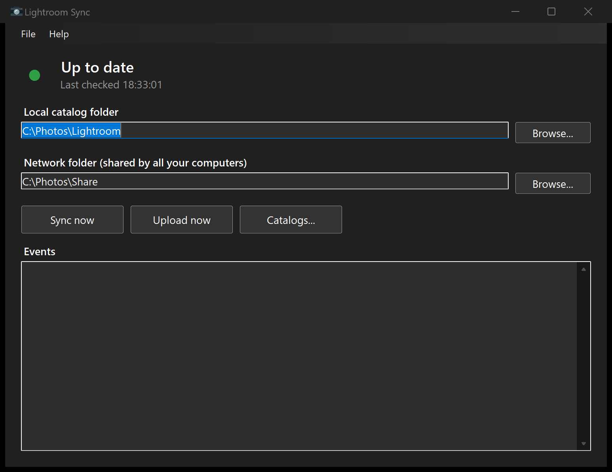

# LightroomSync

A tool to manage your Lightroom Classic catalogs across multiple Windows computers.

Lightroom catalogs are designed to be single-user, and Lightroom won't even let you run your catalog from a network folder, even though all your photos are on that NAS. But if you're like me, you want to work on your photos in multiple locations (such as your laptop on the couch for triaging, and your main workstation for more advanced editing). This means having to manually copy your catalog around, and that's a pain. Well no more! This program will save your catalog(s) to a network folder, and automatically update your local catalogs if a newer version is on the network.



This is a maintained fork of [software-2/LightroomSync](https://github.com/software-2/LightroomSync) by Anthony Bryan, who wrote the original.

## Features

- Automatically uploads a zip of your catalog to your network folder as soon as you close Lightroom.
- Automatically replaces your catalogs with the newest version on the network.
- Prevents you from having Lightroom open on multiple machines at once to avoid conflicts and overwriting work.
- Can launch at startup in the system tray - never think about this problem again!
- **Keeps your previous catalog as a backup** whenever it is replaced (you choose how many versions), and a **Catalogs** window can restore the previous version.
- **Pauses by itself** when the network folder is unreachable and resumes when it is back. No more crashes when the NAS is off.
- Never replaces your catalog until the new one is downloaded, extracted and checked. Uploads use a temporary name on the share, so other computers never read a half-written zip.
- Status indicator, progress bar, tray notifications, dark mode and a **built-in User Guide** (Help > User Guide, or F1).
- Self-contained installer: no need to install .NET.

## Setup Instructions

- Get the latest installer from the [Releases](https://github.com/manichon01/LightroomSync/releases) page, or build from source (see below).
- On each machine, specify the directory where all your catalogs are stored locally.
- Specify a common network location that all machines can access. This is where catalogs will be stored.
- With Lightroom closed, click **Upload now** on the first machine to save its catalogs to the network folder.
- On your other machines, click **Sync now** to grab every catalog from the network.
- If you want this to run all the time, select File > Launch At Startup. It will silently run in the system tray.
- From then on, just use Lightroom. After detecting Lightroom has closed, the app zips and uploads your catalogs. The full walkthrough is in the in-app User Guide.

## Building from source

You need the .NET 10 SDK.

```
dotnet build
```

To build the self-contained installer, publish and then compile `InnoSetup.iss` with [Inno Setup](https://jrsoftware.org/isinfo.php):

```
dotnet publish LightroomSync/LightroomSync.csproj -c Release -r win-x64 --self-contained -o publish
ISCC.exe InnoSetup.iss
```

The installer is written to the `installer` folder.

## Troubleshooting

### My catalog is missing! Oh my God!

If something went wrong, please [file a bug report](https://github.com/manichon01/LightroomSync/issues) so it can be fixed. But worry not, your catalogs should still be available on the network share, and the previous local version is kept in the `LightroomSync Backup` folder inside your local catalog folder (the **Catalogs** window can restore it). The zips in the network share are never deleted by this program as a safety measure. (And as a better backup solution than Adobe's.)

### The program crashed or isn't working.

Please file a bug report here on GitHub. In the app there's an event textbox. Please copy/paste that into your bug report, as it will likely give a better idea of what's going on. More help is in Help > User Guide.

### Where is the Mac version!

This program uses tons of Windows-specific calls, so it'd likely need to be rewritten. The config file is simple JSON though, so if you want to make a version that's compatible with this, it could certainly be done.

## License

MIT. Original work copyright (c) 2023 Anthony Bryan. See [LICENSE](LICENSE).
